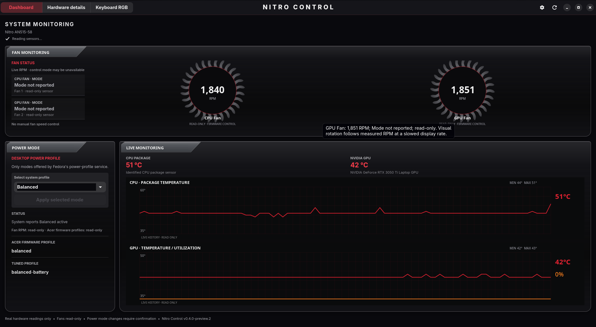
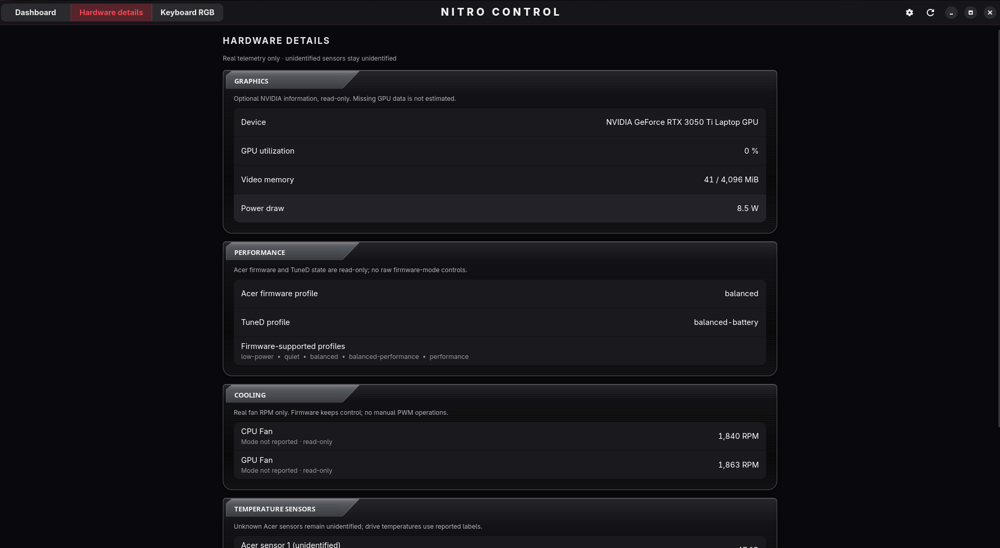
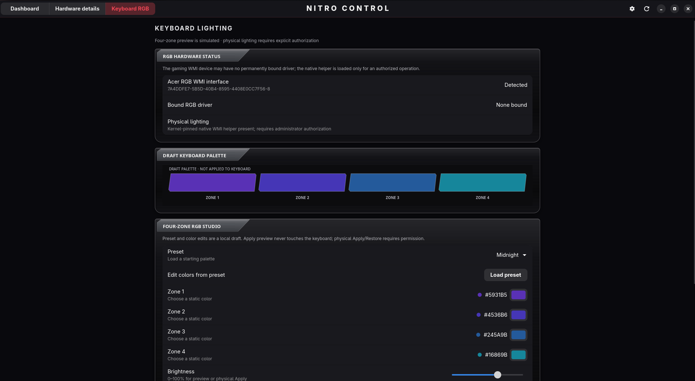

# Nitro Control

**A native GNOME dashboard for Acer Nitro laptops, initially tested against the AN515-58 interface.**

Version 0.4.0-preview.3 **(source preview)** • optional AN515-58 fan control and experimental Acer WMI RGB • Python 3.11+ • MIT license

[Release notes for v0.4.0-preview.3](docs/RELEASE-v0.4.0-preview.3.md)

Nitro Control is a small Python + GTK4 + Libadwaita application using native Linux APIs. Desktop power-mode switching uses Fedora’s standard D-Bus service. v0.3 adds optional, explicitly authorized physical RGB support **only when a supported kernel sysfs endpoint already exists**. The GUI never runs as root or directly calls WMI. An optional, separately installed native-RGB development backend can execute a root-owned, one-shot WMI kernel module while keeping stock `acer_wmi` loaded. It never writes fan PWM.

## Screenshots

### Dashboard



### Hardware Details



### Keyboard RGB



## Optional GNOME top-bar indicator (merged in main)

The optional `--tray` feature was merged from
[PR #9](https://github.com/tobiasGuta/Nitro-Control/pull/9) after live
Fedora 45/GNOME verification. It exposes a
**StatusNotifierItem/AppIndicator** icon through GNOME's
[AppIndicator and KStatusNotifierItem Support
extension](https://extensions.gnome.org/extension/615/appindicator-support/).
Its read-only menu shows available CPU/GPU temperatures and actual
fan RPM, plus **Open Nitro Control**, **Refresh readings** and
**Quit tray**. The Fedora optional dependency is
`libayatana-appindicator-gtk3`, running in its **own GTK3 process**,
separate from the full GTK4 dashboard. Missing sensors stay unavailable.

For manual tray-only use, run
`/usr/bin/python3 -m nitro_control --tray`. The
[merged dashboard setting](https://github.com/tobiasGuta/Nitro-Control/pull/11),
**Keep Nitro-Control in the system tray**, enables the indicator
directly from the normal GUI's top-right gear menu: turn it on once,
close the dashboard, and the read-only tray stays active. The setting persists
per user and is **off by default**; no login autostart occurs.
The indicator remains a separate GTK3 process, and the dashboard stays
GTK4. An independent guarded login-autostart script remains an explicit
extra opt-in only. Neither feature installs kernel drivers, changes
RGB/fan/power state, or modifies the GNOME extension. The published
`v0.4.0-preview.2` tag predates this enhancement.
See [tray usage, new GUI setting, and Fedora checklist](docs/TRAY-INDICATOR.md).
GTK/Ayatana warnings remain tracked in [#10](https://github.com/tobiasGuta/Nitro-Control/issues/10).

## NitroSense-inspired dashboard (v0.4.0-preview.2)

Nitro Control now features an original **GTK4/Cairo** graphite-and-red
dashboard inspired by the owner's NitroSense screenshots. It includes
independently animated, **read-only** CPU/GPU fan RPM turbines on the
reference AN515-58; actual CPU/GPU temperature and GPU-utilization history;
a compact Fedora power-profile selector; and matching metallic Hardware
Details and four-zone RGB editor pages. Missing sensors remain unavailable
rather than turning into invented readings or simulated spikes. The fan
animation is slowed for display; the RPM numbers are the real readings.

The power-profile confirmation flow and four-zone RGB
**Polkit authorization + 100%-brightness native WMI initialization guard**
are unchanged. The preview release provided fan monitoring. The fan-control
release adds the optional controls described below.

The owner visually reviewed all three pages, ordinary/maximized
layout, and confirmed the local-only RGB preset/preview/reset workflow
and power-profile confirmation flow on Fedora 45. Find published tags and archives on the
[GitHub Releases page](https://github.com/tobiasGuta/Nitro-Control/releases).
Read [v0.4.0-preview.2 release notes](docs/RELEASE-v0.4.0-preview.2.md)
for new features, Fedora dependency requirements (`python3-cairo`),
GUI-only installation/rollback and known limitations.
See also [GUI design/validation notes](docs/NITROSENSE-UI-REDESIGN.md).

## Optional fan control (AN515-58)

In **Dashboard → Fan monitoring**, choose **Auto**, **Max**, or **Custom**.
Custom provides separate CPU and GPU sliders with per-fan Auto toggles. Max
asks for confirmation. On the reference AN515-58, all three modes worked
through stock `acer_wmi` while the power profiles stayed on Balanced.

Install the optional helper from this source checkout, then launch or update
the dashboard from the same checkout:

```bash
sudo ./scripts/install-fan-helper-fedora.sh
/usr/bin/python3 -m nitro_control
```

See the [fan-control guide](docs/FAN-CONTROL.md) for setup, hardware results,
troubleshooting, and removal.

## v0.4.0-preview.1: native AN515-58 RGB while preserving stock Acer monitoring

On November 6, 2026, the **existing isolated red-only PoC** physically restored
all four keyboard zones on the reference Nitro AN515-58, Fedora 45,
kernel `7.2.15-300.fc45.x86_64`. The original `acer_wmi` driver, Acer fan
telemetry and platform profile remained working; Fn+F9/Fn+F10 controlled
brightness. Simply unloading/reloading `acer_wmi` did not restore the light.

This preview adds an **opt-in experimental** configurable four-zone WMI
backend, an explicit **Restore lighting** GUI button, and pinned module install
and uninstall tools. Uniform green at WMI brightness **100** preserved normal
Fn brightness controls on November 6, 2026, while green/65 caused unexpected
color changes. Native WMI Apply/Restore therefore now requires **100% in the
editor**, with a second guard in the privileged backend and kernel module.
Dim physically afterward with Fn+F9/Fn+F10. It runs only through a separately
installed, administrator-authorized helper; there is **no automatic boot or
suspend recovery**, no blacklisting, and no permanently loaded custom module.

**Physically verified, November 6, 2026:** the reference AN515-58 on Fedora 45
successfully displayed four distinct colors, retained functional Fn brightness
keys, kept stock `acer_wmi` and fan telemetry working, survived one
suspend/resume cycle, and retained its selected colors before GDM and after
login across one reboot. This does not guarantee other models, kernels or
future cold boots. Root-module/Polkit failure-path tests are synthetic;
live authentication denial and forced module-failure cases remain untested.

**November 2026 field follow-up:** A keyboard blackout initially blamed on
updates was recovered with the manually authorized 100%-brightness WMI Restore.
Investigation then found the unused Linuwu driver still registered for the
same Acer WMI device as stock `acer_wmi`; it initialized during boot despite
its disabled service. After the owner removed the legacy Linuwu module,
the **first ordinary reboot and suspend/resume both passed**: four-zone RGB
colors, Fn brightness and fans remained functional. **The original blackout
cause is not proven.** Full timeline, commands, hardware validation and
remaining questions: **[November 2026 RGB incident investigation](docs/RGB-INCIDENT-2026-11.md)**
([issue #3](https://github.com/tobiasGuta/Nitro-Control/issues/3)).

See **[Native WMI RGB: architecture, exact install steps, evidence, tests,
troubleshooting and rollback](docs/NATIVE-RGB.md)** and
**[v0.4.0-preview.1 release notes](docs/RELEASE-v0.4-preview.1.md)**.
This feature is not installed just by launching the dashboard: the
current-kernel development module and root-owned Polkit helper require
separate, explicit installation. Never use `make install` from Linuwu
Sense or enable automatic kernel module loading. Startup RGB recovery
is not needed on the verified reference laptop.

## v0.3: RGB studio and gated physical backend

The reference AN515-58 has a user-confirmed four-zone RGB keyboard, and Linux
exposes its numbered RGB WMI GUID. The stock `acer_wmi` exposes no RGB writer, but this exact machine has now passed temporary physical four-zone tests with a locally patched Linuwu Sense driver. The physical Apply button is enabled only when a supported driver and the opt-in helper are actually present. The GUID alone does not provide a safe control endpoint.

The studio has four GTK color selectors, brightness, presets, a simulated
Apply preview/Reset, and an optional physical Apply button. Preview remains
strictly in-memory. A separate, root-owned one-shot helper can be installed
explicitly *after* a supported native LED or Linuwu sysfs endpoint exists. The
GUI asks confirmation for each physical change; the optional Polkit helper
requires administrator authorization (with opt-in short-lived caching). An optional kernel-pinned, on-demand module installation is available; boot autoload remains disabled by default.

## v0.2.0 capabilities

- Live CPU package temperature from an *identified* `coretemp` / `k10temp` sensor.
- Acer fan RPM and automatic/manual mode reporting through `/sys/class/hwmon`.
- Acer firmware temperatures, with **unidentified** labels preserved rather than guessing their physical role.
- NVIDIA GPU temperature, utilization, VRAM, and power usage via `nvidia-smi` when available.
- NVMe drive temperatures, current firmware platform profile and its allowed choices, current TuneD profile.
- RGB WMI interface discovery, including numbered instances such as `...-8`, and indication of whether a driver is bound.
- Periodic refresh on a background thread; missing sensors are displayed as unavailable.
- Clearly labeled demo mode and a one-shot JSON diagnostic mode.
- Optional GNOME power-mode selection through `org.freedesktop.UPower.PowerProfiles`; only modes actually advertised by the service are offered.
- Explicit Apply and confirmation dialog, asynchronous D-Bus change, re-read verification, and gracefully disabled controls when the service is unavailable.
- Long Acer firmware profile names now wrap instead of being cut off in a narrow suffix.

### Compatibility

The initial reference machine is Acer Nitro AN515-58, Fedora 44, GNOME Wayland, kernel 7.2.7, Intel Iris Xe + RTX 3050 Ti. Other Linux laptops can run the app; unsupported Acer features will simply be shown as unavailable. This is **not** a guarantee of compatibility with other models or releases.

## Run from a checkout on Fedora

Install the native libraries (no `pip` or privileged application process needed):

```bash
sudo dnf install python3-gobject gtk4 libadwaita
```

From the project directory:

```bash
/usr/bin/python3 -m nitro_control --demo      # sample values; no hardware changes
/usr/bin/python3 -m nitro_control             # live dashboard
/usr/bin/python3 -m nitro_control --once      # JSON snapshot without GTK
```

The built-in demo values are **examples, not readings from your device**. If `nvidia-smi` is unavailable, the NVIDIA panel reports unavailable and the rest of the application continues working. Demo mode does not permit power changes.

### Upgrade an existing installation

The installer copies source into the per-user application directory. After pulling the new version, rerun it and relaunch the window:

```bash
git pull --ff-only
./scripts/install-fedora.sh
```

### Add to GNOME's app launcher

From the project directory:

```bash
./scripts/install-fedora.sh
```

This installs a *per-user copy* into `~/.local/share/nitro-control`, a launcher under `~/.local/bin`, and a `.desktop` file. No `sudo` is needed for the installation script once the native libraries above are present. Open **Nitro Control** from the GNOME app grid, or run `~/.local/bin/nitro-control`. The launcher uses the installed application directory rather than the caller's current directory, so invoking it from an older Git checkout cannot accidentally import that checkout's outdated Python package. Existing users should rerun `./scripts/install-fedora.sh` from updated `main` to receive the launcher fix; this does not reinstall kernel modules or change RGB firmware.

Remove only these installed copies with `./scripts/uninstall.sh`. This does not remove your source checkout or dependencies.

## Tests

The collector and JSON mode use only the Python standard library; GTK is imported only for the GUI. Run these on any Python 3.11+ system:

```bash
python3 -m unittest discover -s tests -v
python3 -m compileall -q nitro_control tests
python3 -m nitro_control --demo --once
```

Tests use a disposable simulated sysfs tree shaped like the AN515-58, plus an injected fake power-profile service. They cover Acer fans and temperatures, NVIDIA CLI parsing and failures, firmware choices, WMI suffixes, driver binding, read-only monitoring, allowed desktop modes, denied changes, and verification of service-reported results. GUI rendering and live D-Bus/Polkit behavior require a Fedora/GNOME environment; CI does not claim to test the GNOME window or change a real power mode.

## Safety and privacy

- Hardware monitoring is read-only and runs as your normal desktop user. Power-mode changes occur only after explicit user confirmation.
- No telemetry, network requests, root GUI, fan curves, or direct EC/WMI calls from the unprivileged GUI. The preview stays in-memory. The optional administrator-authorized native WMI backend runs a separate, locally built and kernel-pinned experimental module for a single apply, then unloads it. The independent third-party Linuwu replacement remains an explicit opt-in fallback.
- The desktop power-mode operation uses only the standard D-Bus `ActiveProfile` property. The optional RGB path invokes a **root-owned** one-shot helper through `pkexec`; nothing privileged is imported from the user-writable GUI installation.
- Power Saver, Balanced, and Performance are desktop modes. The five Acer firmware-supported names remain read-only; do not assume a one-to-one mapping.
- JSON output includes device model and measurements, not hostname, machine ID, MAC address, or exact filesystem paths.
- Fan settings use a separate root-owned Polkit helper and are independent of the desktop power-profile controller.
- An Acer WMI GUID can be present on a device with different physical keyboard variants. Its presence is **not** proof of four-zone RGB.

## Project layout

```text
nitro_control/
  __main__.py       CLI, demo, JSON, GUI launch
  ui.py             GTK4/Libadwaita dashboard
  hardware.py       isolated read-only hardware adapters
  fan_control.py    stock Acer hwmon detection and privileged fan writes
  fan_client.py     unprivileged client for the optional fan helper
  profiles.py       optional desktop power-mode service with validation
  rgb.py            validated four-zone plans and in-memory preview backend
  rgb_hardware.py   exact-model, exact-endpoint sysfs RGB adapters
  rgb_client.py     unprivileged client for optional Polkit helper
  rgb_privileged.py root-owned, one-shot RGB entry point
  native_rgb.py     optional pinned WMI one-shot controller (root helper only for writes)
  models.py         typed immutable snapshots
  demo.py           explicitly labeled example data
scripts/            per-user install and uninstall
 tests/             synthetic hardware tests
```

## Roadmap

- v0.2: Desktop power-mode switching through the standard system service, with confirmation.
- v0.3 preview.2: Simulated lighting editor, read-only RGB probe, gated hardware adapters and optional Polkit helper.
- v0.3 preview.3: Physical four-zone and GUI integration validated on the reference laptop; add disabled-by-default, reversible on-demand Fedora driver service.
- v0.4.0-preview.1: opt-in guarded native Acer gaming WMI RGB while stock `acer_wmi` stays loaded; exact-model hardware tests, rollback and upgrade documentation.
- Later: suspend/reboot qualification, explicitly enabled startup recovery (not included yet), packaging and broader hardware testing.

## References

- [Linux hwmon sysfs](https://docs.kernel.org/hwmon/sysfs-interface.html)
- [Linux platform-profile API](https://docs.kernel.org/userspace-api/sysfs-platform_profile.html)
- [PyGObject GTK4 introduction](https://pygobject.gnome.org/tutorials/gtk4/introduction.html)
- [Libadwaita application window](https://gnome.pages.gitlab.gnome.org/libadwaita/doc/main/class.ApplicationWindow.html)
- [NVIDIA System Management Interface](https://docs.nvidia.com/deploy/nvidia-smi/)
- [Power Profiles D-Bus interface](https://upower.pages.freedesktop.org/power-profiles-daemon/gdbus-org.freedesktop.UPower.PowerProfiles.html)
- [Linux multicolor LED userspace ABI](https://kernel.org/doc/html/next/leds/leds-class-multicolor.html)
- [AN515-58 RGB kernel RFC (not a shipped driver guarantee)](https://www.spinics.net/lists/kernel/msg6183499.html)

## License

MIT. See `LICENSE`.


## Optional physical RGB backend (v0.3.0-preview.2)

The four-zone studio continues working **without any new driver or privilege**. A
**read-only** diagnostic checks your actual hardware:

```bash
/usr/bin/python3 -m nitro_control --rgb-probe
```

With stock `acer_wmi` and **no separately staged native WMI helper**, the read-only RGB probe reports `"available": false`. When the guarded native WMI module is installed for the current kernel and the model/driver/HWMON checks pass, it can report `"backend": "native-wmi"` without loading the module. The reference laptop also validated a separate Linuwu Sense four-zone sysfs writer during explicitly managed sessions. Never mistake the WMI GUID alone for a writable endpoint.

The **legacy sysfs adapters** recognize only these existing, documented sysfs
interfaces, on the exact model and WMI GUID:

- Four native `acer-wmi::kbd_backlight_1` through `_4` Linux multicolor LED
  devices. Each must have validated `multi_index`, `multi_intensity`,
  `brightness`, and `max_brightness` attributes.
- Linuwu Sense's documented `four_zoned_kb/per_zone_mode` endpoint, accepting
  exactly four RGB hex colors and brightness.

Native multicolor LEDs are preferred when present. After the legacy sysfs
backends, the v0.4 opt-in native WMI controller is recognized only with its
current-kernel, root-owned staged module and strict Acer HWMON prerequisites.
Unsupported, partial, malformed, or absent backends fail closed. No unknown GUID calls, direct EC
access, kernel compilation, fan writes, or automatic driver installation are included in the GUI. A separate opt-in installer provides an explicitly managed, current-kernel-only module session; fan monitoring and desktop power controls remain separate.

**Once a supported writer exists**, an optional administrator-owned helper may
be installed *explicitly* from a reviewed source checkout:

```bash
sudo ./scripts/install-rgb-helper-fedora.sh
```

This copies a minimal, standalone Python helper and dependencies into root-owned
`/usr/local/libexec` and installs a dedicated PolicyKit action. It never imports
modules from the user's writable installation. The GUI still runs as your user,
requires a separate confirmation per hardware change, and invokes the fixed
helper through `pkexec`. By default, the action uses `auth_admin` and prompts on every hardware apply.
For an explicit, short-lived Polkit authorization cache (typically about five
minutes), reinstall the helper with:

```bash
sudo ./scripts/install-rgb-helper-fedora.sh --cache-authorization
```

This selects `auth_admin_keep` **only for Nitro Control's dedicated RGB action**;
it is not permanent passwordless root access. The GUI still asks confirmation
for every physical change, and the root helper continues to validate exact
model, endpoint and four-zone input. Cache reuse depends on the running Polkit
version/session; another password prompt may still occur. Return to a password
on every change by reinstalling with no option. Errors or denied authorization
are displayed as failures. To remove it:

```bash
sudo ./scripts/uninstall-rgb-helper-fedora.sh
```

A successful sysfs readback is only **software-level verification**: visually
confirm the keyboard really changed. Some firmware reports accepted values
without changing LEDs. The on-demand service restores the saved lighting on normal stop; suspend/resume and reboot behavior remain to be tested on hardware.
Read [the hardware safety and validation guide](docs/RGB-HARDWARE.md) before
trying a third-party driver or kernel patch.


## On-demand physical RGB driver (v0.3.0-preview.3)

After successful **temporary** uniform, independent-zone and GTK GUI tests on
the reference AN515-58, Nitro Control provides an **opt-in, disabled-on-boot**
service that pins the locally patched Linuwu `.ko` to the exact running Fedora
kernel. No `acer_wmi` blacklist or upstream `make install` is used. Close the
GUI without changing the keyboard back; stop the service to restore the
previous lighting and stock Acer driver. See the full preflight, rollback,
manual start/stop and kernel-upgrade guidance in [RGB-HARDWARE.md](docs/RGB-HARDWARE.md).

This is experimental third-party kernel code, **not** part of the MIT-licensed
Nitro Control application. Nitro Control does not bundle or redistribute the
Linuwu source or binary. The kernel module is supplied from the user's own
locally built, patched copy. Do not enable boot autoload until a separate
on-demand, suspend/resume and reboot validation.
